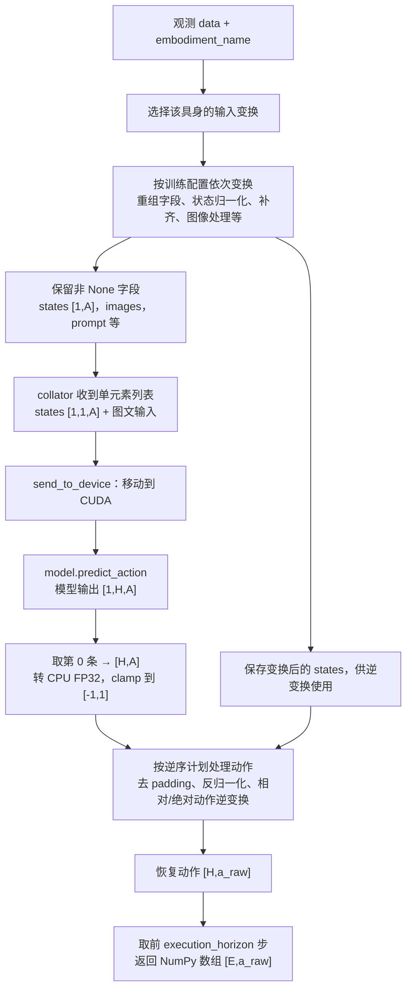

# Deployment

部署服务加载 `save_pretrained` 格式的 checkpoint，通过 WebSocket 接收单条观测，调用模型的 `predict_action`，再将动作恢复到输入变换前的尺度和维度后返回。

## 文件分工

| 文件 | 作用 |
| --- | --- |
| [server.py](/resVLA/deployment/server.py) | Hydra 启动入口，读取运行参数，创建 policy 和 WebSocket 服务 |
| [policy.py](/resVLA/deployment/policy.py) | 加载模型与 processor，构建输入/逆变换，执行推理 |
| [websocket.py](/resVLA/deployment/websocket.py) | 处理连接、metadata、请求路由、响应和空闲退出 |
| [protocol.py](/resVLA/deployment/protocol.py) | 使用 MessagePack 编解码消息，支持 NumPy 数组和标量 |

## 启动服务

在项目根目录执行，替换 checkpoint 路径，并使用与训练时输入变换一致的任务配置：

```bash
python -m resVLA.deployment.server \
  task=resvla_libero \
  +checkpoint_dir=/path/to/checkpoint/step_10000 \
  +host=0.0.0.0 \
  +port=10093 \
  +device=cuda \
  +dtype=bf16
```

任务配置中的归一化统计文件路径也必须可访问。服务从配置提取并实例化 transform，不实例化训练数据集、DataLoader 或优化器。

| 参数 | 默认值 | 含义 |
| --- | --- | --- |
| `checkpoint_dir` | 必填 | 含模型和 processor 的 checkpoint 目录 |
| `host` | `0.0.0.0` | 监听地址；客户端使用服务机器的实际地址连接 |
| `port` | `10093` | WebSocket 端口 |
| `device` | `cuda` | 推理设备，也可指定 `cuda:0` 等 CUDA 设备；当前 policy 不支持 CPU |
| `dtype` | `bf16` | 支持 `bf16/bfloat16`、`fp16/float16`、`fp32/float32/none` |
| `idle_timeout` | `-1` | 正数表示空闲退出秒数，每 5 秒检查一次；非正数不启用 |

参数既可放在配置顶层，也可放在 `server` 节点，顶层同名参数优先。`fp32/float32/none` 在当前实现中表示不向加载器显式传 dtype，并关闭 policy 外层 autocast；它不会强制将所有模型参数或模型内部计算转换成 FP32。

### CheckpointPolicy 初始化

1. 注册模型类型，用 `AutoModel.from_pretrained`、`AutoProcessor.from_pretrained` 从 checkpoint 加载模型和 processor，将模型移动到 CUDA 并设为 eval。
2. 校验任务顶层的 `action_dim`、`action_horizon` 与 checkpoint 一致。horizon 优先读取模型配置，缺失时读取 `model.action_tokenizer.config`。
3. 复用 `train.dataloader.collate_fn` 配置，但将 processor 替换为 checkpoint 中的 processor。
4. 搜索配置中的 `TransformDataset` 节点，按具身名称建立输入 transform、逆变换和元信息。

每套变换需要 `InjectEmbodiment`、一个受支持的 `Normalizer` 或 `StepwiseNormalizer`，以及与模型动作维度一致的 `PadStateAction`。归一化配置必须包含 `action_norm_stats.mask`，代码用它的**长度**恢复原始动作宽度；其中 False 表示该维度不做归一化，不表示部署时应删掉该维度。

配置中的具身必须存在于模型的 `embodiment_config`，或兼容读取的 `part_dims` 中。多个配置使用同一具身名时，归一化签名必须一致，否则报错；一致时沿用第一套已注册变换。

模型还需要提供 `predict_action(batch)`，collator 必须能接收 checkpoint processor 并处理单条观测。不能仅因为文件是 checkpoint 就直接使用纯动作 tokenizer 的训练配置部署。

## 单次推理的数据流程



其中 `H` 是模型动作长度，`A` 是模型补齐后的动作维度，`a_raw` 是原始动作宽度，`E` 是本次返回的执行长度。当前 policy 每次只处理一条观测，内部 batch 大小固定为 1。

`CheckpointPolicy.predict_action(data, embodiment_name, execution_horizon)` 的主要处理为：

1. 确定具身名称。优先使用显式 `embodiment_name`，否则从 `data` 中按 `embodiment`、`embodiment_name`、`embodiment_tag` 的顺序查找；缺失或未注册则报错。
2. 对观测执行训练配置中的输入变换。完成后需要有 `states`、`images`、`prompt`，状态应为单时刻的 `[1,A]`。缺失的真实动作无需提供；变换产生的顶层 `None` 字段会在组 batch 前移除。
3. 在 inference mode 下运行模型，取 `[0]` 得到 `[H,A]`，转成 CPU FP32，并统一 clamp 到 `[-1,1]`。
4. 按输入变换的逆序执行受支持的输出恢复操作，随后截取前 `E` 步，返回 `{"actions": numpy_array}`。省略 `execution_horizon` 时返回全部动作，指定时要求 `1 ≤ E ≤ 输出动作长度`。

输出恢复只处理代码支持的以下变换，并不是自动逆转任意 transform：

| 输入变换 | 输出恢复操作 |
| --- | --- |
| `PadStateAction` | 按原始动作宽度去掉补齐维度 |
| `Normalizer` | `Unnormalizer` |
| `StepwiseNormalizer` | `StepwiseUnnormalizer` |
| `ToDeltaAction` | 在配置 mask 指定的动作维度上加回状态 |
| `ToAbsoluteAction` | 在配置 mask 指定的动作维度上减去状态 |

例如输入顺序为归一化 → 补齐，输出顺序就是去补齐 → 反归一化。返回动作的相对/绝对语义取决于这套逆变换计划，不能一概视为绝对动作。`execution_horizon` 只截取结果，不减少模型生成的 horizon。

## 请求与响应

### 连接后先读取 metadata

服务地址形如 `ws://127.0.0.1:10093`。连接成功后，服务端立即发送一个 MessagePack 编码的 metadata 字典：

```python
{
    "checkpoint_dir": "/absolute/path/to/checkpoint",
    "model_type": "ResVLA",  # 实际模型的类名
    "action_dim": 32,       # 模型维度，包含 padding
    "action_horizon": 16,
    "embodiments": ["franka"],
}
```

上面的数值仅作示例，实际以 checkpoint 和已注册变换为准。metadata 没有 `status` 或 `data` 外层包装，客户端应先接收它，再开始收发请求。

### 推理请求

推荐使用明确的 `type`、`request_id` 和 `payload`：

```python
request = {
    "type": "predict_action",  # 也接受 "infer"
    "request_id": "step-1",
    "payload": {
        "embodiment_name": "franka",
        "execution_horizon": 8,
        "data": {
            "state": state_array,
            "images": {
                "cam_high": image_array,
                "cam_wrist": wrist_image_array,
            },
            "prompt": "pick up the object",
        },
    },
}
```

这里展示的是便捷观测格式：`state` 为未执行训练变换的原始状态向量，`images` 为相机名到图像的字典，`prompt` 为任务文本。相机名使用 `RepackTransform` 的**输出侧名称**，示例中的 `cam_high/cam_wrist` 需与实际配置一致。三项同时存在时，policy 会先根据 repack 映射还原源字段布局，再执行完整输入变换，因此不要提前做归一化或 padding。

也可直接在 `data` 中提供符合源字段映射的原始观测，例如配置需要的 `observation.state`、`observation.images.image`、`task` 等；具体键和嵌套方式由 repack 映射决定。便捷格式使用单数 `state`，不要与变换后字段 `states` 混淆。

路由也兼容省略 `payload` 的旧式顶层请求，以及省略 `type` 的请求（默认 `predict_action`）。省略 `request_id` 时使用 `"default"`。新客户端使用上面的完整格式即可。

### 成功、失败与 ping

推理成功返回：

```python
{
    "status": "ok",
    "ok": True,
    "type": "inference_result",
    "request_id": "step-1",
    "data": {"actions": actions_array},  # NumPy [E,a_raw]
}
```

推理异常、未知请求类型或非字典请求会返回 `status="error"`、`ok=False`、`type="inference_result"`，错误文本位于 `error.message`。这些路由层错误通常不会主动关闭连接；若发生 MessagePack 解码等 handler 层异常，服务发送文本 traceback 后，以内部错误码关闭连接。因此客户端应区分二进制协议帧和文本异常帧。

发送 `{"type": "ping", "request_id": "health"}` 可获得 `{"status": "ok", "ok": True, "type": "ping", "request_id": "health"}`，不会调用模型。空闲计时在成功解包收到的消息后更新，ping 也会刷新计时。

## 通信编码与客户端示例

通信使用 **MessagePack 二进制帧**。应使用本项目 `protocol.packb/unpackb`，或兼容其 NumPy 标记的实现；普通 JSON 无法直接替代。数组会记录原始字节、dtype 与 shape，解包后恢复 NumPy 数组。协议不支持 object、void/结构化、complex dtype，也不直接编码 PIL 图像或 Torch tensor。

下面的单次调用示例使用便捷观测格式；将图片路径、状态、具身和执行长度替换成实际值：

```python
import asyncio

import numpy as np
from PIL import Image
from websockets.asyncio.client import connect

from resVLA.deployment import protocol


async def main():
    async with connect("ws://127.0.0.1:10093", compression=None, max_size=None) as ws:
        metadata = protocol.unpackb(await ws.recv())
        print(metadata)

        request = {
            "type": "predict_action",
            "request_id": "step-1",
            "payload": {
                "embodiment_name": "franka",
                "execution_horizon": 8,
                "data": {
                    # 示例占位：应换成设备当前真实状态，维度与训练配置一致。
                    "state": np.zeros(8, dtype=np.float32),
                    "images": {
                        "cam_high": np.asarray(Image.open("camera.png").convert("RGB")),
                        "cam_wrist": np.asarray(Image.open("wrist.png").convert("RGB")),
                    },
                    "prompt": "pick up the object",
                },
            },
        }
        await ws.send(protocol.packb(request))
        frame = await ws.recv()
        if isinstance(frame, str):
            raise RuntimeError(frame)
        response = protocol.unpackb(frame)
        if not response["ok"]:
            raise RuntimeError(response["error"]["message"])
        actions = response["data"]["actions"]
        print(actions.shape)


asyncio.run(main())
```

服务支持在一个连接上继续发送后续观测。当前 handler 同步调用 policy，没有请求批处理或独立推理队列；客户端可以按“发送观测 → 接收动作”的顺序循环调用。
