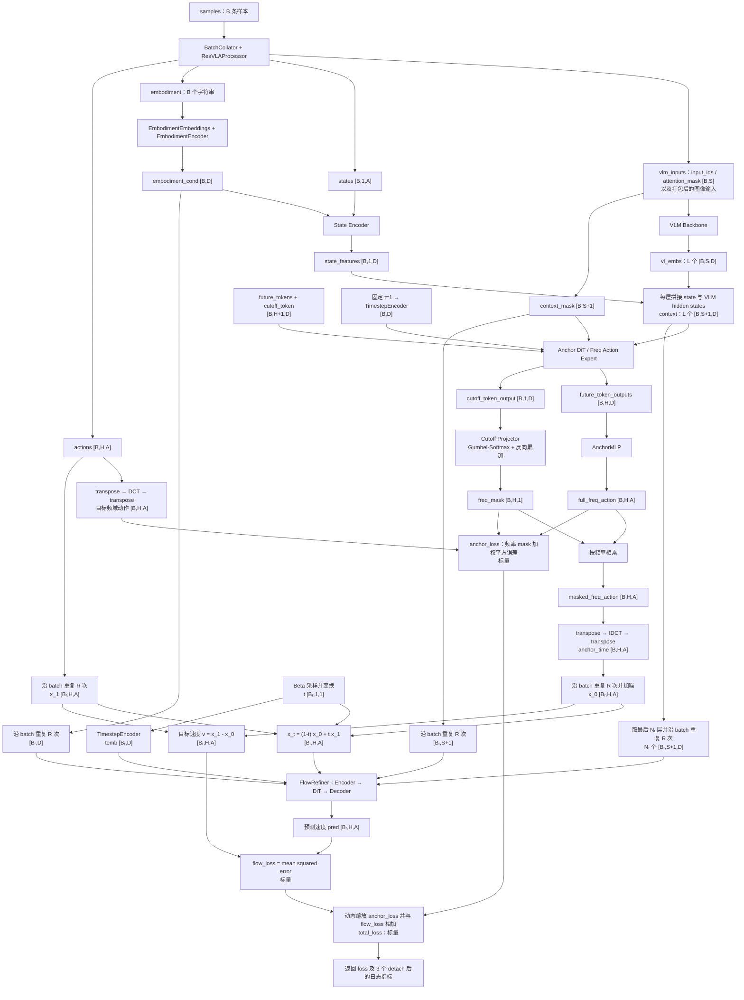
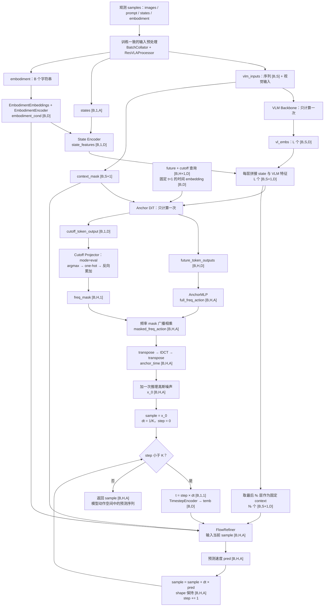

## Shape 约定

以进入模型的 `actions.shape = [bs, horizon, action_dim]` 为起点，使用以下简写：

| 符号 | 含义 |
| --- | --- |
| `B` | `bs`，原始 batch 大小 |
| `H` | `horizon = config.action_horizon`，动作序列长度，也是 DCT 频率分量数；默认 16 |
| `A` | `action_dim = config.action_dim`，模型动作/状态的统一维度；默认 32 |
| `D` | `config.hidden_size`，取自 VLM 的 `text_config.hidden_size` |
| `S` | batch 内 padding 后的图文 token 序列长度 |
| `L` | `vlm_outputs.hidden_states[1:]` 的元素数 |
| `Nₐ` / `Nᵣ` | Anchor DiT / Refiner DiT 的层数；默认 19 / 9 |
| `R` | `num_repeat_diffusion_steps`，训练时每条样本的重复次数；默认 2 |
| `Bᵣ` | `B × R`，Flow Matching 训练时扩展后的 batch 大小 |
| `K` | `num_inference_steps`，推理时 Euler 积分步数；默认 4 |

`[B,H,A]` 在时域表示“每个样本的 H 步动作”，在频域表示“每个样本的 H 个频率系数”。Shape 相同，但第二维的含义不同。状态只取一个时刻，shape 为 `[B,1,A]`，不是 `[B,H,A]`。

## Training：从 sample 到全部 loss

### 数据流程图



### 1. 从单条 sample 组成 examples

最终 `examples` 中供 `forward` 使用的字段为：

```python
examples = {
    "vlm_inputs": {...},               # 图文编码及 attention_mask
    "actions": Tensor[B, H, A],
    "states": Tensor[B, 1, A],
    "embodiment": [name_0, ..., name_B_minus_1],
    # collator 还保留 images、prompt、各种 mask 等字段
}
```

以上是 shape 示意，不是可直接执行的 Python 类型声明。当前 `ResVLA.forward` 只读取这四个字段；`action_mask`、`state_mask` 和注入的动作时间戳没有参与本模型的 loss 或时间编码。

### 2. VLM 提取各层图文特征

`forward` 从 `actions.shape[0]` 得到 `B`，将 `vlm_inputs` 传给 `self.vlm`，开启 `output_hidden_states=True`、关闭 cache。随后执行：

```python
vl_embs = list(vlm_outputs.hidden_states[1:])
attention_mask = inputs["attention_mask"].bool()
```

`vl_embs` 是包含 `L` 个张量的列表，每个张量为 `[B,S,D]`；这里跳过 embedding 层输出，保留各层 hidden states，并未把层维度堆叠成一个新张量。`attention_mask` 为 `[B,S]`，`True` 表示有效图文 token。

VLM 的调用包在 CUDA BF16 autocast 中；后续模块处于代码中的 CUDA FP32 autocast 块内。本文描述 shape，不将 autocast 上下文等同于所有中间张量都已显式转换为 FP32。

### 3. 编码具身类型和当前状态

`EmbodimentEmbeddings` 把每个具身名称映射到 `embodiment_config` 中的索引，查表得到具身 embedding；随后通过 `EmbodimentEncoder` 生成条件向量：

```text
embodiment_names：B 个字符串
  → ids [B]
  → Embedding [B,D]
  → Linear + SiLU [B,2D]
  → Linear → embodiment_cond [B,D]
```

状态通过 `ActionStateEncoder`：

```text
states [B,1,A]
  → W1 + SiLU [B,1,2D]
  → W2 [B,1,D]
  → embodiment_cond 调制的 AdaRMSNorm 与门控残差
  → state_features [B,1,D]
```

AdaRMSNorm 将条件 `[B,D]` 投影到 `[B,3D]`，扩展为 `[B,1,3D]` 后拆成 `scale`、`shift`、`gate`，各为 `[B,1,D]`。状态编码器执行 `a_emb + gate * normalized`，不会增加 token 数或改变最终 shape。具身条件在这里调制状态特征，之后还会调制 Flow Refiner 的动作编码与解码。

### 4. compute_anchor：用查询 token 预测频域动作特征

`compute_anchor` 不把真实动作输入 Anchor DiT。其查询来自模型参数：

| 操作 | Shape 变化 |
| --- | --- |
| 扩展 `future_tokens` | `[1,H,D] → [B,H,D]` |
| 扩展 `learnable_cutoff_token` | `[1,1,D] → [B,1,D]` |
| 沿 token 维拼接 | `[B,H,D] + [B,1,D] → anchor_input [B,H+1,D]` |
| 每层 VLM 特征前拼接状态 token | `[B,1,D] + [B,S,D] → context[i] [B,S+1,D]` |
| 图文 mask 前补一个有效状态位置 | `[B,1] + [B,S] → context_mask [B,S+1]` |
| 固定时间条件 | 全 1 的 `dummy_timesteps [B,1] → time_cond [B,D]` |

`TimestepEncoder` 的具体 shape 为 `[B,1] → [B,128] → [B,256] → [B,2D] → [B,D]`：先乘以 128 个频率，再拼接 cosine/sine，最后通过两层 MLP。

Anchor DiT 的第 `i` 层使用 `context[i]`，因此实际消费 `vl_embs` 的前 `Nₐ` 层；每层输出都保持 `[B,H+1,D]`。其时间条件固定为 1，与后面 Flow Matching 随机采样的 `t` 是两回事。最终得到：

```text
anchor_output [B,H+1,D]
  ├─ [:, :H, :] → future_token_outputs [B,H,D]
  └─ [:, H:, :] → cutoff_token_output [B,1,D]
```

### 5. 解码频域系数并决定保留哪些频率

`AnchorMLP` 把所有 future token 一起展平，再预测整段频域动作，具体为：

```text
future_token_outputs [B,H,D]
  → Flatten [B,H×D]
  → Linear + LayerNorm + SiLU [B,D]
  → Linear [B,H×A]
  → view → full_freq_action [B,H,A]
```

`LearnableCutoffProjector` 只接收 cutoff token，生成频率 mask：

```text
cutoff_token_output [B,1,D]
  → Linear + LayerNorm + SiLU [B,1,D]
  → Linear → logits [B,1,H]
  → gumbel_softmax(tau=1.0, hard=True) → one_hot [B,1,H]
  → flip + cumsum + flip → 前缀 mask [B,1,H]
  → squeeze(1) [B,H]
  → unsqueeze(-1) → freq_mask [B,H,1]
```

若 one-hot 选中下标 `k`（从 0 开始），mask 的 `0…k` 位置为 1，其余为 0，即保留 `k+1` 个最低频分量，至少保留 DC 分量。例如 `[0,0,1,0]` 变成 `[1,1,1,0]`。训练时前向是硬选择，反向通过 Gumbel-Softmax 的 straight-through 估计传播梯度。

将 mask 沿动作维广播：

```text
masked_freq_action = full_freq_action * freq_mask
                    [B,H,A]          * [B,H,1]
                  → [B,H,A]
```

这里“截断”只是把高频系数置零，张量仍保留 `H` 个频率位置，并不会缩短为 `[B,k+1,A]`。

### 6. DCT 目标与 anchor_loss

真实动作 `actions` 的第二维是时间，但 `BlockDCT` 对最后一维做矩阵乘法，因此必须先转置：

```text
actions [B,H,A]
  → transpose(1,2) [B,A,H]
  → BlockDCT：乘以固定的 [H,H] 正交 DCT 矩阵 [B,A,H]
  → transpose(1,2) → target_freq_action [B,H,A]
```

也就是说，对每个动作维度分别沿 `H` 步时间轴变换，不在动作维度 `A` 上做 DCT。

记完整预测频域动作为 `F`、目标频域动作为 `Y`、mask 为 `m`，则当前实现为：

$$
\mathcal L_{anchor}
= \frac{\sum_{b=1}^{B}\sum_{h=1}^{H}\sum_{a=1}^{A}
m_{b,h,1}(F_{b,h,a}-Y_{b,h,a})^2}
{\sum_{b=1}^{B}\sum_{h=1}^{H}m_{b,h,1}+10^{-8}}.
$$

Shape 依次为：相减 `[B,H,A]` → 平方 `[B,H,A]` → 乘 mask `[B,H,A]` → 求和为标量；分母也为标量，最终 `anchor_loss.shape = []`。

分母是 `freq_mask.sum()`，没有再乘 `A`。因此它对保留的频率位置取平均、对动作维度求和，并不是对所有有效标量元素的普通 MSE。代码比较的是 `full_freq_action` 与 DCT 目标，再给误差乘 mask；未保留的频率不计入这一项 loss。这里的 mask 是频率 mask，当前实现没有另外排除补齐的动作维度。

### 7. IDCT 得到时域 anchor

将截断后的频域动作逆变换回时域：

```text
masked_freq_action [B,H,A]
  → transpose(1,2) [B,A,H]
  → BlockIDCT：乘以固定的 [H,H] 逆变换矩阵 [B,A,H]
  → transpose(1,2) → anchor_time [B,H,A]
```

`anchor_time` 是后续 Flow Matching 的基础起点；只有加噪后才成为训练中的 `x_0`。

### 8. 扩展 batch，并构造 Flow Matching 的输入和目标

为每个样本构造 `R` 份训练实例，代码沿 batch 维使用 `repeat_interleave(R, dim=0)`：

| 张量 | 重复前 | 重复后 |
| --- | --- | --- |
| 时域 anchor | `[B,H,A]` | `[Bᵣ,H,A]` |
| 真实动作 `x_1` | `[B,H,A]` | `[Bᵣ,H,A]` |
| `embodiment_cond` | `[B,D]` | `[Bᵣ,D]` |
| 最后 `Nᵣ` 层的 state + VLM context | 每层 `[B,S+1,D]` | 每层 `[Bᵣ,S+1,D]` |
| `flow_context_mask` | `[B,S+1]` | `[Bᵣ,S+1]` |

例如 `B=2,R=2` 时，顺序为 `[样本0, 样本0, 样本1, 样本1]`。所有条件采用相同顺序，确保对齐。`R` 增加的是带独立噪声/时间的训练实例数，不是训练中的积分步数；VLM 与 anchor 只在原始 batch 上计算一次。

然后生成与动作相同 shape 的高斯噪声：

$$
\epsilon\sim\mathcal N(0,I),\qquad
x_0=\operatorname{repeat}(anchor\_time)+\sigma_{train}\epsilon,\qquad
x_1=\operatorname{repeat}(actions).
$$

`noise`、`x_0`、`x_1` 都为 `[Bᵣ,H,A]`，`σ_train = fm_noise_std`，默认 1。

`sample_time` 为扩展后的每个实例采样一个时间：

$$
u\sim\operatorname{Beta}(\alpha,\beta),\qquad t=s(1-u),
$$

其中默认 `α=1.5`、`β=1.0`、`s=0.999`。实际返回 shape 为 `[Bᵣ]`（函数 docstring 的 `[B,1]` 与实现不同），随后两次 `unsqueeze` 变为 `[Bᵣ,1,1]`。

```text
t [Bᵣ,1,1]
  → TimestepEncoder 内 squeeze [Bᵣ,1]
  → 频率展开 [Bᵣ,128]
  → cos/sin 拼接 [Bᵣ,256]
  → MLP [Bᵣ,2D] → temb [Bᵣ,D]
```

时间沿 horizon 和 action_dim 广播，构造直线路径上的输入与目标速度：

$$
x_t=(1-t)x_0+t x_1,\qquad v_{target}=x_1-x_0.
$$

`noisy_traj = x_t`、`velocity = v_target` 均为 `[Bᵣ,H,A]`。Flow Refiner 实际接收的是插值后的 `x_t`；真实动作 `x_1` 用于构造插值和监督目标。

### 9. FlowRefiner 预测速度并计算 flow_loss

`self.flow` 的输入为轨迹 `x_t`、时间 embedding、具身条件、最后 `Nᵣ` 层的图文/状态 context 及对应 mask。内部 shape 为：

```text
noisy_traj [Bᵣ,H,A]
  → ActionStateEncoder：W1 + SiLU [Bᵣ,H,2D]
  → W2 + 具身条件调制 [Bᵣ,H,D]
  → Nᵣ 层 DiT + 输出调制/投影 [Bᵣ,H,D]
  → ActionStateDecoder：具身条件调制 [Bᵣ,H,D]
  → W1 + SiLU [Bᵣ,H,2D]
  → W2 → pred [Bᵣ,H,A]
```

Refiner 第 `i` 层消费 `vl_embs[-Nᵣ:][i]` 对应的 context；不会把不同 VLM 层沿 token 维拼成一个超长序列。代码要求 `L ≥ Nₐ` 且 `L ≥ Nᵣ`；前 `Nₐ` 层与后 `Nᵣ` 层是否重叠由这些配置决定。

预测的 `pred` 是速度，训练时直接与 `velocity` 比较：

$$
\mathcal L_{flow}
=\frac{1}{B_r H A}\sum_{b,h,a}
\left(\hat v_{b,h,a}-(x_1-x_0)_{b,h,a}\right)^2.
$$

代码执行 `((pred - velocity).float() ** 2).mean()`：`[Bᵣ,H,A] → [Bᵣ,H,A] → []`。这里对 batch、时间、动作维度的所有元素一起取平均，没有使用频率 mask 或动作 padding mask。训练只做一次扩展 batch 的速度预测，不运行推理时的 Euler 循环。

### 10. 合并 loss 并返回全部指标

总 loss 使用当前两个 loss 的数值动态缩放 anchor 项：

$$
c=\frac{\operatorname{stopgrad}(\mathcal L_{flow})}
{\operatorname{stopgrad}(\mathcal L_{anchor})+10^{-8}},\qquad
\mathcal L_{total}=\mathcal L_{flow}+c\,\lambda\,\mathcal L_{anchor},
$$

其中 `λ = anchor_loss_weight`，默认 0.1。`detach()` 使比例 `c` 本身不参与反向传播。当 anchor loss 远大于 epsilon 时，总 loss 的数值约为 `(1+λ) × flow_loss`，但梯度仍包含独立的 anchor 监督，不能把它替换为 `(1+λ) × flow_loss` 来训练。

| 返回字段 | Shape | 用途 |
| --- | --- | --- |
| `loss` | `[]` | 未 detach 的 `total_loss`，用于反向传播 |
| `losses/total_loss` | `[]` | detach 后的总 loss，用于日志 |
| `losses/flow_loss` | `[]` | detach 后的 Flow Matching loss，用于日志 |
| `losses/anchor_loss` | `[]` | detach 后、尚未乘动态系数和权重的 anchor loss，用于日志 |

当前没有额外的语言建模 loss、cutoff 分类 loss 或独立时域 anchor 重建 loss。训练路径中的 `anchor_time`、`x_0` 和 `velocity` 均未 detach，所以 flow loss 也能沿插值输入以及目标速度中的 anchor 分支反传；只有总 loss 中用于计算相对权重的两个数值被 detach。

### 补充：两个 DiT 内部的 shape

用 `B′` 表示当前 batch、`T` 表示查询长度。Anchor 使用 `B′=B,T=H+1`；训练 Refiner 使用 `B′=Bᵣ,T=H`。两者 context 长度均为 `S+1`。

设 query head 数为 `nq`、KV head 数为 `nkv`、每头宽度 `d=D/nq`：

| 操作 | Shape |
| --- | --- |
| 输入 / 时间条件 | `x [B′,T,D]` / `temb [B′,D]` |
| AdaRMSNorm | 条件投影 `[B′,3D] → [B′,1,3D]`，调制后的 `x` 仍为 `[B′,T,D]` |
| Q 投影与分头 | `[B′,T,D] → [B′,nq,T,d]` |
| K、V 投影与分头 | `[B′,S+1,D] → [B′,nkv,S+1,d]` |
| Q/K LayerNorm 与 RoPE | 不改变 shape |
| attention 与输出投影 | 合并头后为 `[B′,T,D]` |
| 门控残差 | `[B′,T,D]` |
| FFN | `[B′,T,D] → [B′,T,2I] → 两个 [B′,T,I] → [B′,T,D]`，`I=D×3//8` |
| FFN 门控残差 | `[B′,T,D]` |
| DiT 最后调制与投影 | `temb → [B′,2D]`，拆出 shift/scale 并广播；输出仍为 `[B′,T,D]` |

本模型传入 context，因此每个 `DiTBlock` 执行一次 cross-attention 加 FFN，没有额外的 query self-attention 子层。`context_mask [B′,S+1]` 用于排除图文 padding，状态位置恒有效；SDPA 中广播为 `[B′,1,1,S+1]`，FlashAttention 路径会打包有效 K/V，最终输出 shape 相同。

## Predict Action：从观测到动作序列

### 数据流程图



### 1. 准备推理输入并复用条件编码

`ResVLA.predict_action(examples)` 只读取 `vlm_inputs`、`states`、`embodiment`，无需真实 `actions`。如果从原始 sample 开始，应使用训练一致的状态归一化、维度补齐和图文编码。缺失的 `actions` 字段应省略，避免把 `None` 交给 `default_collate`。

推理从 `states.shape[0]` 得到 `B`，执行与训练相同的 VLM、具身编码、状态编码和 `compute_anchor`：

```text
vlm_inputs → vl_embs：L 个 [B,S,D]
embodiment → embodiment_cond [B,D]
states [B,1,A] → state_features [B,1,D]
查询 [B,H+1,D] + context + 固定时间条件
  → anchor_output [B,H+1,D]
  → future_token_outputs [B,H,D]、cutoff_token_output [B,1,D]
```

这里没有 `repeat_interleave`，batch 始终为 `B`。`num_repeat_diffusion_steps` 不参与推理。

### 2. 用确定性 cutoff 选择得到时域 anchor

频域动作解码仍为 `[B,H,D] → [B,H×D] → [B,D] → [B,H×A] → [B,H,A]`。截断分支显式传入 `mode="eval"`：

```text
cutoff_token_output [B,1,D]
  → logits [B,1,H]
  → argmax(dim=-1) [B,1]
  → one_hot [B,1,H]
  → 反向累加 [B,1,H]
  → squeeze + unsqueeze → freq_mask [B,H,1]
```

这里对给定 logits 直接选择最大值，不再采样 Gumbel 噪声。注意 `LearnableCutoffProjector` 按显式 `mode` 参数分支；仅调用 `model.eval()` 不会改变其默认 `mode="train"`，而 `predict_action` 已显式选择 eval 分支。

之后为：

```text
full_freq_action [B,H,A] × freq_mask [B,H,1]
  → masked_freq_action [B,H,A]
  → transpose [B,A,H]
  → IDCT [B,A,H]
  → transpose → anchor_time [B,H,A]
```

推理没有真实动作，不计算目标动作的 DCT，也不计算任何 loss。

### 3. 准备固定 context 和积分起点

取最后 `Nᵣ` 层 VLM 特征，各自前拼状态 token，得到 `Nᵣ` 个 `[B,S+1,D]` 的 `res_bridge_vl_embs`；对应 `flow_context_mask` 为 `[B,S+1]`。具身条件为 `[B,D]`。这些条件在整个积分循环中复用。

仅在循环开始前加一次噪声：

$$
x_0=anchor\_time+\sigma_{infer}\epsilon,\qquad
\epsilon\sim\mathcal N(0,I),
$$

其中 `σ_infer = inference_fm_noise_std`，默认 0.5；噪声和 `sample=x_0` 都为 `[B,H,A]`。因此即使 cutoff 采用 argmax，默认推理仍因起点噪声具有随机性。之后的积分步骤不会重新加噪。

### 4. Euler 积分：从 t=0 推进到 t=1

令 `dt = 1/K`。第 `k` 次迭代（`k=0,…,K-1`）执行：

$$
t_k=k/K,\qquad
\hat v_k=\operatorname{FlowRefiner}(x_k,t_k,context,embodiment\_cond),\qquad
x_{k+1}=x_k+\frac{1}{K}\hat v_k.
$$

| 每轮步骤 | Shape |
| --- | --- |
| 创建当前时间 `t` | `[B,1,1]`，全 batch 都取 `k/K` |
| 时间编码 | `[B,1,1] → [B,1] → [B,128] → [B,256] → [B,2D] → [B,D]` |
| 编码当前 `sample` | `[B,H,A] → [B,H,2D] → [B,H,D]`，含具身调制 |
| Refiner DiT | `[B,H,D] → [B,H,D]`，由时间和固定 context 条件化 |
| 解码预测速度 | `[B,H,D] → [B,H,2D] → pred [B,H,A]`，含具身调制 |
| Euler 更新 | `sample + pred * dt → [B,H,A]` |

默认 `K=4` 时，在 `t=0、0.25、0.5、0.75` 处计算速度，依次把状态推进到 `0.25、0.5、0.75、1.0`。最后一次更新后直接返回，不额外在 `t=1` 调用 Refiner。

训练借助真实动作构造 `x_t` 和目标速度；推理通过当前 `sample` 预测速度并积分。两者使用同一个 Flow Refiner，推理过程中没有可供插值的真实 `x_1`。

### 5. 返回值及模型外的后处理

`ResVLA.predict_action` 返回一个 `[B,H,A]` 的 tensor，不返回 loss 字典。若训练使用归一化后的动作，这里输出也处于相同的归一化动作空间。该方法本身没有反归一化、移除 padding、裁剪数值范围或截取执行步数。

`predict_action` 使用 `@torch.inference_mode()` 关闭梯度记录，但该装饰器本身不会切换模块的 train/eval 状态；实际推理调用方应将模型设为 eval。
