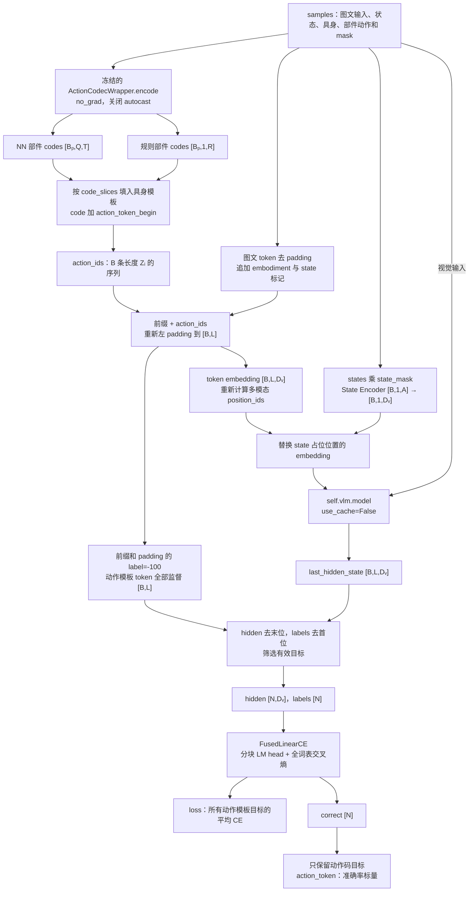
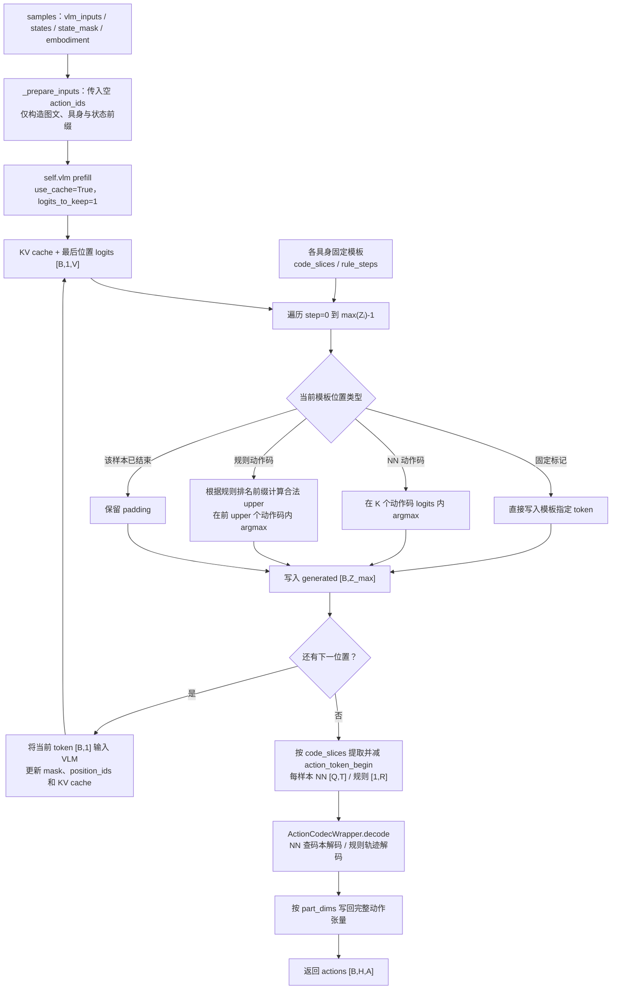

# TokenFlow Stage 2：V2

`TokenFlowAR` 继承 `PreTrainedModel`，内部组合 VLM（`self.vlm`）、状态编码器（`self.state_encoder`）和冻结的 action codec（`self.action_tokenizer`）。它根据图像、语言、具身类型和当前状态，自回归预测结构化动作 token 序列，再解码为连续动作。

训练时用真实动作生成 token 标签，对动作序列执行 teacher forcing；推理时不需要真实动作，按各具身的固定模板逐位置生成动作码。本文从本目录接口接收的 `samples` 开始说明。

## 文件分工

| 文件 | 内容 |
| --- | --- |
| [configuration_tokenflow_ar.py](./configuration_tokenflow_ar.py) | `TokenFlowARConfig`：VLM/codec 配置、动作词表、token ID 与具身部件维度 |
| [processing_tokenflow_ar.py](./processing_tokenflow_ar.py) | `TokenFlowARProcessor`：扩充 Qwen3-VL tokenizer，并设置左侧 padding |
| [action_codec_wrapper.py](./action_codec_wrapper.py) | `ActionCodecWrapper`：统一部件动作与 codes 的编解码，区分神经网络部件和规则部件 |
| [modeling_tokenflow_ar.py](./modeling_tokenflow_ar.py) | `TokenFlowAR`：构造动作模板、注入状态 embedding、训练及自回归推理 |
| [modular_tokenflow_ar.py](./modular_tokenflow_ar.py) | `FusedLinearCE`：分块执行 LM head 投影与交叉熵，提供自定义反向传播 |

## Shape 约定

| 符号 | 含义 |
| --- | --- |
| `B` | batch 大小，即具身名称列表长度 |
| `Bₚ` | 某个部件在 batch 中的有效样本数 |
| `H` | codec 配置中的 `action_horizon`，每次输出的动作步数 |
| `A` | `config.action_dim`，模型完整动作/状态维度；默认 32 |
| `M` | codec 配置中的 `max_part_dim`，神经网络部件的统一动作维度 |
| `Dᵥ` | `config.vlm_config.text_config.hidden_size`，VLM hidden size |
| `D꜀` | codec 的 `hidden_size`，动作 latent 宽度，与 `Dᵥ` 不必相同 |
| `K` | codec 的 `codebook_size`，也是动作码 token 的数量 |
| `Q` | codec 的 `num_quantizers`，RVQ 级数 |
| `T` | codec 的 `num_tokens // num_quantizers`，每级的 latent 位置数 |
| `R` | `rule_codec.num_tokens`，每条规则部件轨迹的 token 数 |
| `G` | `rule_codec.num_valid_sequences`，规则轨迹的合法排名总数 |
| `Sᵢ` | 第 `i` 条输入经 attention mask 去掉 padding 后的图文 token 数 |
| `Zᵢ` | 第 `i` 条样本的完整动作模板长度，含开始、结束和部件标记 |
| `L` | 训练时拼接并左 padding 后的长度，`maxᵢ(Sᵢ+2+Zᵢ)` |
| `P` | 推理 prefill 的长度，`maxᵢ(Sᵢ+2)` |
| `V` | LM head 实际词表大小，即 `self.vlm.lm_head.weight.shape[0]` |
| `N` | 训练中非 `-100` 的目标 token 总数；输入满足约定时为 `ΣᵢZᵢ` |

codec 的尺寸来自 `action_tokenizer_config`，不是本模型硬编码的默认值。例如 `Q=4,T=4` 时，一个神经网络部件贡献 `[4,4]`、共 16 个动作码；规则部件贡献 `[1,R]` 个码，不使用 RVQ 的 `[Q,T]` 布局。

## 动作词表与模板

### 1. 配置和 processor

`TokenFlowARConfig` 的 `model_type="tokenflow_ar_v2"`，通过两个子配置组合模型。本版本没有 `from_backbones` 方法，也没有单独的 `action_tokenizer_path` 字段。

| 配置 | 含义 / 初始化行为 |
| --- | --- |
| `vlm_config` | 必需的 VLM 配置；读取其中 `text_config.hidden_size`、`text_config.vocab_size`、`text_config.eos_token_id` 和 `dtype` |
| `action_tokenizer_config` | 必需的 codec 配置，提供部件、具身、码本和量化级等参数 |
| `attn_implementation` | 默认 `"flash_attention_2"`；传给 VLM 构造函数，并写入 codec 配置 |
| `action_dim` | 完整动作和状态维度，默认 32 |
| `part_dims` | 各具身的部件维度映射，决定动作模板和解码写回位置 |
| `token_ids` | 动作与结构 token 的 ID 映射；为空时自动连续分配，非空时沿用传入映射 |
| `vocab_size` | 在 `__post_init__` 中设为 `max(token_ids.values())+1` |
| `pad_token_id` | 在 `__post_init__` 中设为 `vlm_config.text_config.eos_token_id` |

两个子配置若以字典等 `Mapping` 传入，会先取出各自的 `model_type`，通过 `AutoConfig.for_model` 转成配置对象。

未显式提供 `token_ids` 时，以 `vlm_config.text_config.vocab_size` 为起点，按 `action_tokens` 的顺序分配 ID。这里使用的是 **VLM 配置中的词表大小**，并非 `len(tokenizer)`。

`TokenFlowARProcessor.from_transformer_pretrained(path, config)` 的处理顺序是：

1. 用 `Qwen3VLProcessor.from_pretrained(path)` 加载 processor。
2. 若 tokenizer 长度小于 `<action_0000>` 的目标 ID，追加 `<|tokenflow_reserved_{i}|>`，补齐两者之间的间隔。
3. 按 `config.action_tokens` 顺序追加动作与结构 token。
4. 将 `pad_token` 设为 `config.pad_token_id` 对应的 token，并设置 `padding_side="left"`。
5. 保留图像、视频 processor 和 chat template，返回 `TokenFlowARProcessor`。

例如原 tokenizer 长度为 100、VLM 配置词表大小为 104，则先补 4 个 reserved token，使第一个新动作 token 从 ID 104 开始。reserved token 只用于占据 ID 间隔，不进入动作模板。该方法不校验最终 ID 映射；若 tokenizer 原本已超过目标起点，或待添加 token 已存在，就不能假设追加后仍与配置一致。它也没有另行实现 `encode_input`。

新增 token 按以下顺序构造：

| 类别 | Token 形式 | 用途 |
| --- | --- | --- |
| 动作码 | `<action_0000>` 至第 `K-1` 个动作码 token | 表示 codec 输出的整数 code |
| 神经网络部件标记 | `<{part}_{level}>`，每部件 `Q` 个 | 标识当前部件及 RVQ 级别 |
| 规则部件标记 | `<{part}>`，每部件一个 | 标识规则轨迹，例如 gripper |
| 具身标记 | `<embodiment_{name}>` | 作为输入条件 |
| 其他结构标记 | `<state>`、`<action_start>`、`<action_end>` | 状态占位符与动作边界 |

规则部件通过 `rule_based_key_patterns` 对部件名称进行子串匹配，顺序来自 codec 的 `part_config`。全部部件和全部级共享同一段动作码词表：`token_id = action_token_begin + code`，其中 `action_token_begin` 是 `<action_0000>` 的 ID。具体 code 应由哪个部件/哪一级解释，由模板位置与前置标记决定。

### 2. 模型初始化

`TokenFlowAR.__init__` 分别调用 `AutoModelForImageTextToText.from_config(config.vlm_config, ...)` 和 `AutoModel.from_config(config.action_tokenizer_config, dtype=torch.float32)` 创建 VLM 和 codec，再用 `ActionCodecWrapper` 包装 codec。状态编码器根据 `A` 与 `Dᵥ` 创建。两个 `from_config` 调用仅构造模型，本身不加载预训练权重。

VLM 的 dtype 来自 `config.vlm_config.dtype`；codec 显式使用 FP32，随后冻结参数并保持 eval。模型的 `base_model_prefix="vlm"`，训练取 `self.vlm.model` 的 hidden states，推理调用带 LM head 的 `self.vlm`。

**当前代码只设置顶层 `config.vocab_size`，没有同步扩展 `config.vlm_config.text_config.vocab_size`，也没有调用 `resize_token_embeddings`。** processor 添加 token 同样不会改变模型权重尺寸。因此使用前必须确保实际 VLM embedding 和 LM head 已覆盖新增 token ID，且对应权重正确加载；仅创建这份配置和 processor 并不能保证模型可直接处理新增 token。

### 3. 每个具身的动作模板

`config.part_dims[embodiment][part]` 表示该部件占据完整动作向量中的哪些维度。列表为空表示该具身没有这个部件，模板会跳过它。

模板顺序为：

```text
<action_start>
  level 0：依次放置每个有效 NN 部件的标记与 T 个 code
  level 1：依次放置每个有效 NN 部件的标记与 T 个 code
  ...
  level Q-1：依次放置每个有效 NN 部件的标记与 T 个 code
  依次放置每个有效规则部件的标记与 R 个 code
<action_end>
```

这里是**量化级优先、部件次之**，不是先输出一个部件的全部级再换下一个部件。每级内部的 NN 部件顺序、最后的规则部件顺序，都沿用 `part_config` 中相应类别的顺序。

假设只有 `left_arm`、`right_arm`、`right_gripper` 有效，且 `Q=2,T=2,R=1`：

```text
<action_start>
<left_arm_0>  code code
<right_arm_0> code code
<left_arm_1>  code code
<right_arm_1> code code
<right_gripper> code
<action_end>
```

若某具身有 `n_nn` 个神经网络部件和 `n_rule` 个规则部件，模板长度为：

$$
Z=2+n_{nn}Q(1+T)+n_{rule}(1+R).
$$

上例 `Z=16`，其中 9 个是动作码、7 个是结构标记。`templates` 用 `-1` 表示待填的 code 位置；`code_slices` 记录每个部件、每一级的切片；`rule_steps` 记录规则 code 的起点和当前剩余位数，供推理约束使用。

## Training：从 samples 到 loss

### 数据流程图



### 1. 模型入口

`forward(samples)` 需要以下数据，下面为 shape 示意：

```python
samples = {
    "vlm_inputs": {
        "input_ids": Tensor[B, S_max],
        "attention_mask": Tensor[B, S_max],
        "mm_token_type_ids": Tensor[B, S_max],
        # 按输入模态提供 pixel_values、image_grid_thw 等视觉字段
    },
    "states": Tensor[B, 1, A],
    "state_mask": BoolTensor[B, A],
    "embodiment": [name_0, ..., name_B_minus_1],
    "actions_dict": {part: Tensor[B, H, M]},      # 各部件使用相同结构
    "actions_mask": {part: BoolTensor[B, M]},
}
```

`forward` 不直接读取完整 `actions [B,H,A]`。图文输入中的 `mm_token_type_ids` 是必需字段，代码直接索引读取它。视觉张量沿用 processor 的布局，不统一写成 `[B,S_max,Dᵥ]`。

具身对应的 `part_dims` 和样本 `actions_mask` 必须一致：模板要求的部件必须有有效动作可编码，否则填充时取不到对应 codes。

### 2. 冻结 codec，将真实动作转为部件 codes

模型初始化后，将整个 `action_tokenizer` 设为 `requires_grad=False` 和 eval；覆盖的 `train(mode)` 方法也会重新保持 codec 为 eval。因此 Stage 2 的动作标签不通过 codec 反向传播。

`_encode_actions` 在 `no_grad`、关闭 autocast 的上下文中调用 wrapper。wrapper 优先使用底层模型已有的 `encode(samples)`；若没有，使用本文件实现的逐部件兼容路径。

设某部件有 `Bₚ` 个有效样本，兼容路径为：

| 步骤 | Shape / 结果 |
| --- | --- |
| `actions_mask[part].any(-1)` | `[B,M] → present [B]` |
| 按 present 提取动作并转 FP32 | `[B,H,M] → [Bₚ,H,M]` |
| NN 部件：调用 `_part_encoder` | 部件动作、mask、具身/部件 embedding → `[Bₚ,T,D꜀]` |
| NN 部件：调用 `_quantize` | latent → `codes [Bₚ,Q,T]`，使用 eval 模式下的全部 RVQ 级 |
| 规则部件：取 `action[:,0]` | 每条实例取第 0 个动作通道，得到长度 `H` 的 Python 列表 |
| 规则部件：逐条 `rule_codec.encode` | `[Bₚ,R]`，随后 `unsqueeze(1) → [Bₚ,1,R]` |

最终返回长度为 `B` 的列表，每项是该样本的 `{part: codes}` 字典。某个部件没有有效样本时跳过它。规则路径直接使用第 0 个通道，不根据 mask 自动查找通道。

这里不调用 codec 的训练 `forward`，也不使用其 reconstruction、commitment 或 consistency loss；NN 编码时得到的量化指标被丢弃。

### 3. 将 codes 填入具身模板

`_encode_actions` 为每条样本复制相应模板，再按 `code_slices` 将整数码转换为 VLM token ID：

```text
NN codes [Q,T] → 每级 [T] → 加 action_token_begin → 填入对应切片
规则 codes [1,R] → 第 0 行 [R] → 加 action_token_begin → 填入规则切片
结果：action_ids[i] [Zᵢ]
```

此时 `<action_start>`、部件/级别标记、`<action_end>` 已是固定 token ID，只有原本的 `-1` 槽位由真实动作 codes 填充。

### 4. 拼接图文、具身、状态与动作序列

`_prepare_inputs(samples, action_ids)` 对每条样本按 `attention_mask` 移除原图文序列的 padding，然后拼接：

```text
有效图文 token [Sᵢ]
  + [<embodiment_name>, <state>] [2]
  → prefix [Sᵢ+2]
  + action_ids [Zᵢ]
  → sequence [Sᵢ+2+Zᵢ]
```

标签构造为 `[-100] × 前缀长度 + action_ids`。因此图文、具身和状态前缀不作为监督目标，**整个动作模板都作为监督目标**，包括结构标记。

重新按 batch 最大长度左 padding：

| 变量 | Shape | Padding / 附加值 |
| --- | --- | --- |
| `input_ids` | `[B,L]` | 左侧补 `config.pad_token_id` |
| `attention_mask` | `[B,L]` | 有效位置 1，左侧 padding 0 |
| `mm_token_type_ids` | `[B,L]` | 图文位置保留原值，新增具身/状态/动作位置及 padding 为 0 |
| `labels` | `[B,L]` | 前缀与左侧 padding 为 `-100` |

随后用拼接后的 IDs、模态类型、图像/视频 grid 和 mask 调用 `self.vlm.model.get_rope_index`，重新计算多模态位置索引；本实现的推理增量路径按三个位置轴使用 `[3,B,L]` 布局。

### 5. 用状态特征替换 `<state>` embedding

先查 VLM token embedding，得到 `inputs_embeds [B,L,Dᵥ]`。状态单独通过以下路径：

```text
states [B,1,A] × state_mask.unsqueeze(1) [B,1,A]
  → 屏蔽无效状态维度 [B,1,A]
  → 转为 state_encoder 首层权重的 dtype
  → Linear(A,Dᵥ) [B,1,Dᵥ]
  → SiLU + LayerNorm [B,1,Dᵥ]
  → Linear(Dᵥ,Dᵥ) → state_embeds [B,1,Dᵥ]
```

通过 `masked_scatter`，将 `input_ids == <state>` 的位置替换为对应状态 embedding，最终仍为 `[B,L,Dᵥ]`。状态没有被离散化成动作码，也不额外增加多个状态 token；本接口预期每条样本有一个状态占位位置。

`_prepare_inputs` 返回 `inputs_embeds`、mask、位置与模态索引，以及原输入中的视觉字段。图像/视频信息继续由 `self.vlm.model` 处理。

### 6. VLM 前向与 next-token 对齐

训练调用的是 `self.vlm.model(**inputs, use_cache=False)`，获得 `last_hidden_state [B,L,Dᵥ]`，随后执行：

```text
hidden_states[:, :-1] → [B,L-1,Dᵥ]
labels[:, 1:]         → [B,L-1]
valid = labels != -100 → [B,L-1]
hidden_states[valid]   → [N,Dᵥ]
labels[valid]          → [N]
```

这使第 `j` 个位置的 hidden state 预测第 `j+1` 个 token。真实动作 token 已包含在输入中，因此是 teacher forcing：每个动作目标以真实前序 token 为条件，而非训练时逐步生成自身历史。

### 7. FusedLinearCE 与返回指标

`FusedLinearCE.apply(self.vlm.lm_head.weight, hidden_states[valid], labels)` 接收：

```text
weight [V,Dᵥ]
hidden [N,Dᵥ]
labels [N]
```

它按 `chunk_size = max(1, N×Dᵥ // V)` 分块。每块大小记为 `n≤chunk_size`：

```text
hidden_chunk [n,Dᵥ]
  → F.linear(hidden_chunk, weight) → logits [n,V]
  → Triton 按词表分块计算 FP32 max、sum(exp) 和 argmax
  → Triton 合并统计量 → 每个 token 的 CE 与 correct
  → 原地把 logits 改写为平均 CE 的梯度 → PyTorch GEMM 计算参数梯度
```

CUDA 路径使用两个 Triton kernel：先按不超过 4096 个词表项的 tile 计算统计量，再并行生成 loss、correct 和 logits 梯度。目标 logit 在第一次 kernel 中保存，避免第二次原地写入梯度时发生读写竞争。并列最大值取最小词表索引，与 `torch.argmax` 一致。该路径不再物化整块 FP32 scores/softmax 张量；矩阵乘法仍使用 PyTorch。仅支持 CUDA 张量，直接依赖 Triton；不提供 CPU/MPS 回退或 Triton 可用性检查。

最终训练 loss 为全部有效目标的平均交叉熵：

$$
\mathcal L_{CE}=-\frac{1}{N}\sum_{j=1}^{N}
\log\frac{\exp(logits_{j,y_j})}{\sum_{v=1}^{V}\exp(logits_{j,v})}.
$$

虽然只监督动作模板位置，softmax 的分母仍是**完整 VLM 词表**，并未在训练时截取为 `K` 个动作码。结构 token 同样参与 CE，也没有另外的部件或级别 loss 权重。

该函数在 forward 中按 `(softmax-one_hot)/N` 计算并保存 `grad_weight [V,Dᵥ]`、`grad_hidden [N,Dᵥ]`，backward 时乘以上游 `grad_loss`。分块避免同时保留所有位置的 `[N,V]` logits，但仍保存完整权重梯度和 hidden 梯度；`once_differentiable` 表示该自定义反向不支持二阶求导。

`correct [N]` 来自**全词表 argmax**。模型再用目标 ID 是否位于动作码区间筛选准确率：

$$
accuracy=\frac{\sum_j correct_j\,1[y_j\in[action\_token\_begin,action\_token\_begin+K)]}
{\sum_j1[y_j\in[action\_token\_begin,action\_token\_begin+K)]}.
$$

| 返回字段 | Shape | 含义 |
| --- | --- | --- |
| `loss` | `[]` | 全部动作模板目标的平均 CE，保留梯度 |
| `action_token` | `[]` | 仅 NN/规则动作码目标的准确率，detach 后返回；不统计部件和起止标记 |

当前没有动作重建 MSE、codec 训练 loss 或 `loss/total_loss` 等额外返回项。`action_token` 的分母没有保护项，输入应至少包含一个有效动作码目标。

## Predict Action：自回归生成并解码动作

### 数据流程图



### 1. 只准备条件前缀

`predict_action(samples)` 需要 `vlm_inputs`、`states`、`state_mask`、`embodiment`，无需 `actions_dict` 或 `actions_mask`。模型为每条样本创建长度为 0 的 `action_ids`，复用 `_prepare_inputs` 完成前缀拼接和状态 embedding 替换。

```text
前缀有效长度 Sᵢ+2
  → 左 padding 到 P=maxᵢ(Sᵢ+2)
inputs_embeds [B,P,Dᵥ]
attention_mask / mm_token_type_ids [B,P]
position_ids [3,B,P]
```

生成缓存张量 `generated [B,Z_max]`，初值全为 pad token，其中 `Z_max=maxᵢZᵢ`。第一次调用 `self.vlm` 执行完整 prefill，开启 KV cache，并只保留最后位置的 logits `[B,1,V]`。

### 2. 按模板逐位置生成

每个 step、每条样本按模板处理：

- 固定标记位置直接写入 `<action_start>`、部件标记或 `<action_end>`，不让模型自由选择这些 token。
- NN 动作码位置只取 logits 的 `[action_token_begin:action_token_begin+K]`，做 argmax 后加回起始 ID。
- 规则动作码位置进一步缩小合法区间，防止 token 组合对应不存在的轨迹排名，见下一节。
- 若该样本模板已经走完，保持 padding，不再提取其新动作码。

这里采用受约束的 greedy decoding，没有 temperature、top-k 或采样操作。不同于训练中的全词表准确率，推理选择动作码时主动屏蔽普通语言 token 和其他结构标记。

若还有下一位置，将本轮 token `[B,1]` 和已有 cache 输入 `self.vlm`：

| 项目 | Shape / 更新 |
| --- | --- |
| `input_ids` | `generated[:,step:step+1] [B,1]` |
| `attention_mask` | 在原 mask 后追加 `(step < lengths) [B,1]`；已经结束的 padding 位置为 0 |
| `position_ids` | `next_position+step`，重排并扩展为 `[3,B,1]` |
| `past_key_values` | 复用上一轮返回的 KV cache |
| 输出 logits | `[B,1,V]`，用于选择下一位置 |

`next_position [B]` 由前缀多模态位置索引按位置轴和序列轴取最大值后加 1 得到。增量调用不重新传入图像 patch；视觉和状态条件已在 prefill 中进入 cache。

循环长度由模板决定，不按模型提前生成的结束标记停止；`<action_end>` 自身也是模板固定项。最后一个模板 token 写入后直接进入动作解码，不再额外调用一次 VLM。

### 3. 规则部件的合法排名约束

规则 codec 将合法轨迹排名表示为 `K` 进制数字。单个 token 落在 `0…K-1` 并不保证完整排名小于 `G`，因此 `rule_steps` 在每一位提供合法上界。

设已经生成的规则码前缀对应整数 `r`，当前位在内还剩 `m` 位，则代码计算：

$$
upper=\min\left(K,
\left\lfloor\frac{G-1-rK^m}{K^{m-1}}\right\rfloor+1\right).
$$

当前动作码只能从 `0…upper-1` 中选择。前缀排名 `r` 通过对已生成 token 减去 `action_token_begin` 后逐位执行 `r=r×K+code` 得到。

例如 `G=3194,K=2048,R=2`：第一位只能选 0 或 1；第一位选 0 时，第二位可选 `0…2047`；第一位选 1 时，第二位只能选 `0…1145`。因此完整排名最多为 `1×2048+1145=3193`。若 `K=4096,R=1`，唯一一位只能选 `0…3193`。

这些数字用于说明边界计算，实际 `G`、`R` 由所加载的规则 codec 决定。该限制在自回归生成时施加，不是解码后对非法排名做截断或修复。

### 4. 提取 codes，并恢复完整动作

生成结束后，按各具身的 `code_slices` 取出动作码位置，stack 后减去 `action_token_begin`：

```text
generated[i] [Z_max]
  → NN 部件：Q 个长度 T 的切片 → codes[part] [Q,T]
  → 规则部件：1 个长度 R 的切片 → codes[part] [1,R]
  → codes：长度 B 的部件字典列表
```

在关闭 autocast 的上下文中调用 `ActionCodecWrapper.decode(codes, embodiments, part_dims, A)`。若底层 codec 提供原生 `decode`，wrapper 直接转发；否则使用兼容路径：

| 步骤 | Shape / 结果 |
| --- | --- |
| 初始化完整动作 | 全零 `[B,H,A]` |
| 按 `part_dims` 选择具有某部件的样本 | `Bₚ` 个实例，stack 对应 codes |
| NN 部件查表 | `[Bₚ,Q,T] → rvq.from_codes → [Bₚ,T,D꜀]` |
| NN 部件解码 | 根据每个实例的部件宽度构造 `[Bₚ,M]` 的前缀有效 mask；`_part_decoder` 返回 `[Bₚ,H,M]` |
| 规则部件解码 | `[Bₚ,1,R] → 每条取 code[0] → 长度 H 的列表 → [Bₚ,H,1]` |
| 写回完整动作 | 按 `part_dims[embodiment][part]` 的维度顺序，将解码结果的前几个通道填入 `[B,H,A]` |

没有任何部件负责的动作维度保持为 0。兼容规则路径按标量夹爪设计：编码固定读取第 0 通道，解码返回一个通道，部件维度配置应与此一致。

返回的是一个动作 tensor `[B,H,A]`，不是 loss 字典或原始 token 序列；兼容解码路径使用 FP32 的输出张量。动作处于 codec 所使用的数据空间，通常为归一化动作，规则夹爪为规则 codec 的二值输出。本目录方法不执行反归一化、去除完整动作 padding、数值 clamp 或截取执行 horizon。

## 接口与实现约定

- 虽然 VLM 通过 `AutoModelForImageTextToText` 创建，但当前 processor 仍继承 `Qwen3VLProcessor`，模型也依赖 `self.vlm.model.get_rope_index`、`self.vlm.lm_head`、`mm_token_type_ids`、三轴位置索引及 `logits_to_keep` 等接口。不能仅凭 AutoModel 工厂就认为任意视觉语言模型均可直接替换。
- `action_tokenizer_config` 需要包含 codec 的部件、具身、RVQ 与规则配置；wrapper 初始化会直接读取底层 `rule_codec`。不能仅因存在 `_part_encoder` 就认为任意旧版 codec 都满足接口。
- `part_dims` 应为每个具身提供 `part_config` 中所有部件的键，缺失部件用空列表表示。NN 部件的通道数应不超过 `M`，完整动作维度索引应位于 `0…A-1` 且配置一致。
- 动作码 ID 必须形成从 `action_token_begin` 开始、长度为 `K` 的连续区间。processor 与模型的 token 映射必须一致，实际 embedding/LM head 必须覆盖这些 ID；本目录构造函数没有显式调用 `resize_token_embeddings`。
- codec 被冻结、保持 eval，并被声明为严格 FP32 模块。其他模块是否冻结不由这里额外控制；`forward` 中的 CE 可沿 VLM、状态编码器和 LM head 反传。
- `predict_action` 使用 `@torch.inference_mode()`，但不会自动将整个 VLM 切换为 eval；调用方应在推理前执行 `model.eval()`。
- 本目录没有实现独立的训练数据加载、服务协议或动作执行逻辑。上述流程描述的是 `forward`、`predict_action` 和 wrapper 接口内部的行为。
