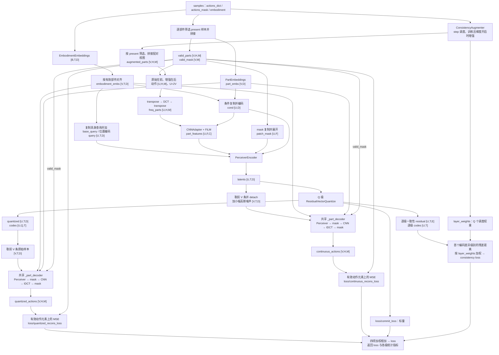
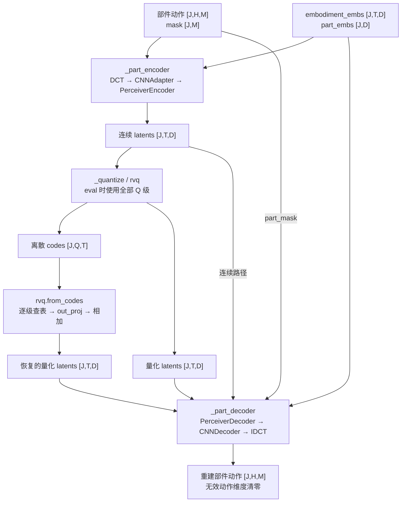

# VQ ActionCodec V2

`ActionCodec` 将各个机器人部件的连续动作序列编码为离散码，并从离散码对应的 latent 重建动作。主路径是：时域动作 → DCT 频域系数 → CNN patch 特征 → Perceiver latent → 残差向量量化（RVQ）→ Perceiver/CNN 解码 → IDCT 时域动作。具身类型与部件类型共同提供条件。

本目录中的实现分工如下：

| 文件 | 内容 |
| --- | --- |
| [configuration_vq_codec.py](./configuration_vq_codec.py) | `ActionCodecConfig`：网络、码本及 loss 配置 |
| [modeling_vq_codec.py](./modeling_vq_codec.py) | `ActionCodec`：部件编码、量化、解码和训练 loss 的组合 |
| [modular_vq_codec.py](./modular_vq_codec.py) | DCT、条件编码、CNN、Perceiver、EMA VQ 和 RVQ 组件 |
| [consistency.py](./consistency.py) | 按 step 调度的平移/幅度增强，以及逐级加权的一致性损失 |

## Shape 约定

模型入口使用按部件组织的动作。若完整动作的概念 shape 为 `[bs,horizon,action_dim]`，本目录中的 `forward` 实际从 `actions_dict` 读取各部件的 `[B,H,M]` 张量，不执行完整动作的拆分。

| 符号 | 含义 |
| --- | --- |
| `B` | 原始 batch 大小，即 `len(samples["embodiment"])` |
| `H` | `action_horizon`，动作序列长度，也是 DCT 频率分量数；默认 16 |
| `M` | `max_part_dim`，每个部件张量的统一动作维度；默认 6 |
| `P` | 输入 `actions_dict` 中的部件数 |
| `Bₚ` | 第 `p` 个部件在 batch 中有效的样本数 |
| `V` | `Σₚ Bₚ`，所有有效“样本—部件”对的数量，即代码中的 `valid_bs` |
| `U` | `2V`，原始部件动作与配对视图拼接后的 batch 大小；未启用增强时配对视图等于原始动作 |
| `D` | `hidden_size`，latent 宽度；默认 512 |
| `C` | `cross_attention_dim`，CNN patch 特征宽度；默认 32 |
| `Q` | `num_quantizers`，RVQ 级数；默认 4 |
| `T` | `num_tokens_per_quantizer = num_tokens // Q`，latent 位置数；默认 `16 // 4 = 4` |
| `F` | `(H-1) × M`，CNN patch 序列长度；默认 90 |
| `E` | `codebook_dim`，码本空间宽度；默认 512 |
| `K` | `codebook_size`，每一级码本的条目数；默认 2048 |
| `N` | `num_layers`，Perceiver 编码器和解码器各自的层数；默认 3 |

一个部件的连续 latent 为 `[T,D]`，离散码为 `[Q,T]`。默认配置得到 **4 个 latent 位置、每个位置 4 级编码，总共 16 个离散码**；量化不会把 latent 序列长度从 4 改成 16。不同级使用独立码本，相同整数 ID 在不同级代表不同向量。

## Training：从模型输入到全部 loss

### 数据流程图



### 1. 读取输入并筛选有效部件

`ActionCodec.forward(samples)` 实际读取三个字段：

```python
samples = {
    "actions_dict": {part_name: Tensor[B, H, M], ...},
    "actions_mask": {part_name: BoolTensor[B, M], ...},
    "embodiment": [name_0, ..., name_B_minus_1],
}
```

以上是 shape 示意。虽然 `forward` 的 docstring 还列出了 `actions`，函数体并未读取该字段。`actions_mask[p][b,m]` 表示某个部件动作维度是否有效，整个时间序列共用这个维度 mask。

先计算 `all_embodiment_embs [B,T,D]`，再按 `actions_dict.items()` 的顺序处理各部件：

```text
part_mask [B,M]
  → any(dim=-1) → present [B]

part_actions[present]       [Bₚ,H,M]
part_mask[present]          [Bₚ,M]
all_embodiment_embs[present] [Bₚ,T,D]
PartEmbeddings(part_name)   [1,D] → expand [Bₚ,D]
```

mask 全为 False 的样本不进入这个部件的计算；如果整个 batch 都没有这个部件，则跳过它。最后沿 batch 维拼接：

| 变量 | Shape |
| --- | --- |
| `valid_parts` | `[V,H,M]` |
| `valid_mask` | `[V,M]` |
| `embodiment_embs` | `[V,T,D]` |
| `part_embs` | `[V,D]` |
| `augmented_parts` | `[V,H,M]`，使用相同 present 筛选、相同部件顺序拼接 |

这里不是把所有部件沿动作维拼接；每个有效“样本—部件”对作为独立计算实例，共享同一套编码器、RVQ 和解码器。`V` 只有在所有样本都具有所有输入部件时才等于 `B×P`。当前实现要求至少存在一个有效部件，否则空列表无法 `torch.cat`。

### 2. 按 step 调度的配对增强：V → 2V

`forward` 先调用 `ConsistencyAugmenter(actions_dict)`，得到与输入字典一一对应的 `augmented_actions` 和长度为 `Q` 的 `layer_weights`，再按各部件的 `present` 筛选原始/增强样本。增强发生在有效部件汇总之前，同一个原始样本的各部件共享增强类型、平移偏移和缩放因子。

#### 调度使用什么 step

`ConsistencyAugmenter` 保存持久化 buffer `num_forwards`。仅在模块处于训练模式且梯度开启时，执行：

```text
step = num_forwards // ema_update_interval
num_forwards += 1
```

这里的 step 是由模块调用次数推算的计数，不是自动读取优化器的 global step。`ema_update_interval` 应与实际梯度累积调用次数一致，才能按预期对应更新步数；计数会随 checkpoint 保存。eval 或 `no_grad` 下既不增加计数，也不执行增强，直接返回原始动作与全零逐级权重。

默认 `consistency_start_step=20000`、`consistency_end_step=80000`。这些是绝对步数，只有总训练步数为 100000 时才对应 20% 和 80%。

- `step < start`：原样返回动作，所有逐级一致性权重为 0。
- `step >= start`：令 `p = min((step-start)/(end-start), 1)`，逐步提高增强幅度和一致性权重。
- 恰好 `step=start` 时已开始增强，但 `p=0`，一致性权重仍为 0；`step>=end` 后保持终值。

| 调度量 | 计算方式 | 默认起点 → 终点 |
| --- | --- | --- |
| 最大平移步数 `delta_max` | `round(delta_start + p*(delta_end-delta_start))` | 1 → 3 |
| 幅度范围 `eps` | `eps_begin + p*(eps_end-eps_begin)` | 0.02 → 0.1 |
| 第 `i` 级权重 `wᵢ` | `p * consistency_layer_weights_end[i]` | 0 → `[1.0,0.7,0.3,0.1]` 对应级别的值 |

#### 增强如何作用于动作

每个样本采样 `kind [B]`，规则为 50% 仅平移、40% 仅缩放、10% 同时平移和缩放；但**幅度缩放仅作用于名称以 `_arm` 结尾的部件**。其他部件在“仅缩放”的 40% 分支中保持原样，在另两种分支中只做平移。

平移偏移的绝对值取自 `1…delta_max`，随机正负；在不平移的分支中置为 0。`time_shift` 按如下索引取值：

$$
\widetilde a_{b,h,m}
=a_{b,\operatorname{clamp}(h+\delta_b,0,H-1),m}.
$$

正偏移读取更靠后的帧，负偏移读取更靠前的帧；越界位置重复边界帧。例如 `[a₀,a₁,a₂,a₃]` 在 `δ=+1` 时变为 `[a₁,a₂,a₃,a₃]`，长度不变。

缩放因子 `scales [B]` 落在 `[1-eps,1+eps]`，在仅平移分支中为 1。对 `_arm` 部件，将其广播为 `[B,1,1]` 乘到平移结果上，保持 `[B,H,M]`；补齐的零仍为零，代码没有额外的数值 clamp。

按有效部件筛选、拼接后，`valid_parts` 和 `augmented_parts` 均为 `[V,H,M]`。调用 `_part_encoder` 前，按“全部原始在前、全部增强在后”的顺序拼接：

```text
动作：[V,H,M] + [V,H,M] → [U,H,M]
mask：复制 [V,M]       → [U,M]
具身：复制 [V,T,D]     → [U,T,D]
部件：复制 [V,D]       → [U,D]
U = 2V
```

原始实例 `v` 与配对实例 `V+v` 对齐。一致性损失依赖这一顺序。即使尚未启用增强或处于 eval，`forward` 仍复制成 `U=2V`，此时两份动作内容相同；并不跳过第二份编码或 commitment 计算。将 `consistency_loss_weight` 设为 0 只关闭其对总 loss 的贡献，不会关闭训练中的增强调度。

### 3. 编码具身与部件条件

`EmbodimentEmbeddings` 查表后，将每个具身 embedding 重排为 `T` 个 token：

```text
B 个具身名称 → ids [B]
  → Embedding [B,T×D]
  → reshape [B,T,D]
  → 有效部件筛选与增强复制 → embodiment_embs [U,T,D]
```

`PartEmbeddings` 将部件名称映射为 `[1,D]`，扩展、拼接和复制后得到 `part_embs [U,D]`。`ConditionEncoder` 融合两者：

```text
embodiment_embs [U,T,D] → flatten [U,T×D]
  + part_embs [U,D]
  → cat [U,(T+1)×D]
  → Linear + SiLU [U,D]
  → Linear → cond [U,D]
```

具身 embedding 既参与条件融合，也作为 Perceiver Encoder 查询的组成部分。`cond` 用于 CNN 的 FiLM 和 Perceiver FFN 的 AdaRMSNorm；部件名称、具身名称分别需要存在于 `part_config`、`embodiment_config` 中。

### 4. 沿时间轴 DCT，再生成 CNN patch 特征

`LayerDCT` 对最后一维执行固定矩阵乘法，所以 `_part_encoder` 先转置动作：

```text
part_actions [U,H,M]
  → transpose(1,2) [U,M,H]
  → 乘以 [H,H] DCT 矩阵 [U,M,H]
  → transpose(1,2) → freq_parts [U,H,M]
```

默认使用正交归一化 DCT。每个动作维度沿 `H` 步时间轴独立变换；输出的第二维变成频率索引。本实现保留全部 `H` 个频率分量，没有学习式频率截断。

`CNNAdapter` 将频域动作当作二维网格，使用 `kernel_size=(2,1)`、`stride=(1,1)`、无 padding 的卷积：

```text
freq_parts [U,H,M]
  → unsqueeze(1) [U,1,H,M]
  → Conv2d(1,C) [U,C,H-1,M]
  → flatten(2) [U,C,F]
  → transpose(1,2) [U,F,C]
  → ConditionalFiLM + SiLU → part_features [U,F,C]
```

这里卷积覆盖相邻两个频率位置，动作维度方向宽度为 1。`ConditionalFiLM` 将 `cond [U,D]` 映射为 `[U,2C]`，拆成 scale/shift 并扩展为 `[U,1,C]`，计算 `(1+scale)×x+shift`，不改变 shape。

同时构造 patch mask，展开顺序与 CNN flatten 的顺序一致：

```text
part_mask [U,M]
  → unsqueeze(1) [U,1,M]
  → expand [U,H-1,M]
  → reshape → patch_mask [U,F]
```

无效动作维度对应的全部 patch 都被标为 False，随后在 encoder cross-attention 中排除。

### 5. Perceiver Encoder：F 个 patch → T 个 latent

查询由具身 token 与可学习 `base_query [1,T,D]` 相加，再加入 sinusoidal 位置编码：

```text
embodiment_embs [U,T,D] + base_query [1,T,D]
  → query [U,T,D] + query 位置编码 [U,T,D]

part_features [U,F,C] + context 位置编码 [U,F,C]
  → context [U,F,C]
```

位置编码由 `SinusoidalPositionalEmbedding` 产生，并乘以 0.1。每层以 `T` 个 query 查询固定的 `F` 个 patch context：

```text
query [U,T,D]
  → N 层 PerceiverTransformerBlock [U,T,D]
  → output_proj [U,T,D]
  → latents z [U,T,D]
```

每个 block 由 cross-attention 残差和条件 FFN 残差组成，没有单独的 latent self-attention 子层。`patch_mask [U,F]` 只屏蔽 context 中的无效 patch，全部 latent query 有效。

### 6. RVQ：逐级量化残差，输出离散码

`_quantize(latents, return_level_data=True)` 调用 `ResidualVectorQuantize`。输入和最终量化 latent 都是 `[U,T,D]`，每一级内部先进入宽度为 `E` 的码本空间，再投影回 `D`。

#### 单级 EMAVectorQuantize

设某一级输入残差为 `rᵢ [U,T,D]`：

| 操作 | Shape |
| --- | --- |
| `in_proj(rᵢ.float())` | `[U,T,D] → z_e [U,T,E]` |
| 合并 batch 与位置 | `[U,T,E] → encodings [U×T,E]` |
| 与全部码本条目计算平方 L2 距离 | `[U×T,E]` 对 `[K,E]` → `[U×T,K]` |
| `argmin` 并重排 | `[U×T] → codes_i [U,T]` |
| 根据 code 查表 | `[U,T] → z_q_proj [U,T,E]` |
| straight-through | `(z_q_proj-z_e).detach()+z_e`，保持 `[U,T,E]` |
| `out_proj` | `[U,T,E] → z_q_i [U,T,D]` |

每个 code 是 `0…K-1` 的整数。前向使用最近的码本向量，反向通过 straight-through 将梯度传给 `z_e`。码本本身为 buffer，使用 EMA 更新，不通过反向传播更新。

该级 commitment loss 先保留每个实例的结果：

$$
\ell_{i,u}=\frac{1}{TE}\sum_{t,e}
\left(z_{e,i,u,t,e}-\operatorname{stopgrad}(z_{q,proj,i,u,t,e})\right)^2.
$$

即逐元素误差 `[U,T,E]`，对位置与通道求平均得到 `commit_i [U]`。

#### 多级残差链与 quantizer dropout

初始 `r₀=z`、累计输出为零。第 `i` 级执行：

$$
q_i=\operatorname{VQ}_i(r_i),\qquad
r_{i+1}=r_i-q_i,\qquad
z_q=\sum_{i=0}^{Q-1}a_iq_i.
$$

训练时为每个实例决定使用的前缀级数 `n_q [U]`：默认使用全部 `Q` 级；以 `quantizer_dropout`（默认 0.2）的概率，将级数替换为 `1…Q` 中的随机整数。`a_i[u] = 1[i < n_q[u]]`，shape `[U]`，乘 latent 时广播成 `[U,1,1]`。eval 时所有实例使用全部级。

当前 dropout 只屏蔽该级对累计 `z_q` 与 commitment loss 的贡献。每一级仍对全部实例计算 codes、更新主残差；满足训练更新条件时也仍统计和更新 EMA 码本。一致性损失也没有用这个 dropout mask 过滤级别。

commitment 的汇总为：

$$
\mathcal L_{commit}=\sum_{i=0}^{Q-1}\frac{1}{U}\sum_{u=1}^{U}a_i[u]\ell_{i,u}.
$$

它包含原始与增强实例，对每一级按完整 `U` 求平均后再相加，没有除以 `Q` 或该级实际激活的实例数。

返回值如下：

| 返回值 | Shape / 结构 |
| --- | --- |
| `quantized` | `[U,T,D]`，各激活级输出相加 |
| `codes` | `[U,Q,T]`，沿第 1 维 stack 各级 codes；包含全部级 |
| `metrics` | commitment loss 和各级码本统计，均为标量 |
| `residuals` | 长度为 `Q` 的列表，每项 `[U,T,E]`，供一致性损失使用 |
| `level_codes` | 长度为 `Q` 的列表，每项 `[U,T]` |

最后两项只在 `return_level_data=True` 时返回。传入 False 时只返回前三项。

### 7. 一致性损失：只约束第一个不同的量化级

RVQ 额外维护一条供一致性损失使用的残差链：

$$
s_0=z,\qquad s_{i+1}=s_i-\operatorname{stopgrad}(q_i),\qquad
\rho_i=\operatorname{in\_proj}_i(s_i).
$$

`s_i` 为 `[U,T,D]`，存入 `residuals[i]` 的 `ρ_i` 为 `[U,T,E]`。它与主残差链的前向数值相同，但减去的早期量化输出被 detach。主残差链 `r_{i+1}=r_i-q_i` 保留这些输出的梯度。

`compute_consistency_loss(residuals, level_codes, V, layer_weights)` 将前 `V` 条视为原始样本、后 `V` 条视为增强样本。对每个 latent 位置，比较两者的逐级 code：

```text
codes_i[:V] 与 codes_i[V:]          → changed [V,T]
此前全部级的 code 是否一致         → prefix_match [V,T]
active = prefix_match & changed    → [V,T]
||ρ_i[V:] - ρ_i[:V].detach()||₂     → distance [V,T]
wᵢ * mean(active * distance)       → 该级加权标量 loss
```

若某个位置两条样本的 code 从第 2 级开始不同，则只在第 2 级计算该位置的一致性惩罚；后续级即使不同也不再激活。所有级都相同时，该位置的贡献为 0。

$$
\mathcal L_{consistency}
=\sum_{i=0}^{Q-1}\frac{w_i}{VT}\sum_{v,t}
active_{i,v,t}\left\|\rho^{aug}_{i,v,t}
-\operatorname{stopgrad}(\rho^{orig}_{i,v,t})\right\|_2.
$$

这里是 **L2 范数，不是平方 L2 或 MSE**；对完整 `[V,T]` 取 mean，而不是除以激活位置数。原始 residual 作为停止梯度的目标，梯度从增强 residual 分支回传。`wᵢ` 是当前调度的逐级权重；该 loss 再乘全局 `consistency_loss_weight` 后进入总 loss。每级还记录未乘 `wᵢ` 的 `changed` 平均值和 `active` 平均值，因此这些统计与 loss 权重分开解释。

### 8. 两路解码：量化 latent 与连续 latent

一致性计算完成后，只保留前 `V` 条原始实例的 `latents` 和 `quantized`，各为 `[V,T,D]`。增强实例不参与动作重建 loss。

- 量化分支直接将 `quantized` 送入 `_part_decoder`。
- 连续分支先取 `latents.detach()`，再加小幅噪声：`ratio = 0.03 * rand([V,1,1])`，`continuous_latents = latents.detach() + randn_like(latents) * ratio`。输出仍为 `[V,T,D]`，每个实例共用一个噪声幅度。

两路共享同一套 decoder 权重，且都使用原始实例的部件/具身条件和 mask。连续分支不会沿输入 latent 回传到 Perceiver Encoder，但 decoder 及重新计算的条件分支仍可获得梯度。

#### Perceiver Decoder：T 个 latent → F 个 patch

`_part_decoder` 重新调用 `ConditionEncoder` 得到 `cond [V,D]`。`PerceiverDecoder` 交换 encoder 的 query/context 宽度：patch query 宽度为 `C`，latent context 宽度为 `D`。

```text
cond [V,D] → cond_proj → query_cond [V,C]
base_query [1,F,C] → expand + 位置编码 → query [V,F,C]
latents [V,T,D] + 位置编码              → context [V,T,D]
  → N 层 PerceiverTransformerBlock
  → output_proj → part_features [V,F,C]
```

Decoder context 的 `T` 个 latent 全部有效，传入的 `context_mask=None`。随后由部件 mask 生成 `[V,F]` 的 patch mask，将无效 patch 特征清零，shape 保持 `[V,F,C]`。

#### CNN Decoder 与 IDCT

```text
part_features [V,F,C]
  → ConditionalFiLM + SiLU [V,F,C]
  → transpose [V,C,F]
  → reshape [V,C,H-1,M]
  → ConvTranspose2d(C,1)，kernel=(2,1) [V,1,H,M]
  → squeeze(1) → freq_parts [V,H,M]
  → transpose [V,M,H]
  → IDCT [V,M,H]
  → transpose → reconstructed_actions [V,H,M]
  → 按 part_mask [V,1,M] 再次清零无效维度 [V,H,M]
```

最终再次应用 mask，是因为 patch 清零后还经过 FiLM、激活和转置卷积。两路分别得到 `quantized_actions`、`continuous_actions`，shape 都是 `[V,H,M]`。

### 9. 重建 loss、总 loss 与返回指标

重建目标是原始 `valid_parts [V,H,M]`。两路都在时域计算平方误差，并且只统计有效动作维度：

$$
n_{valid}=H\sum_{v,m}valid\_mask_{v,m},\qquad
\mathcal L_{recons}(\hat a)=
\frac{\sum_{v,h,m}valid\_mask_{v,m}(\hat a_{v,h,m}-a_{v,h,m})^2}
{n_{valid}}.
$$

代码先转为 FP32 计算未归约 MSE `[V,H,M]`，再通过 `valid_mask.unsqueeze(1) [V,1,M]` 清零无效项，求和并除以有效元素数得到标量。这里按全部有效动作元素平均，不按部件分别平均，也不计算独立频域重建 loss。

总 loss 为：

$$
\mathcal L=
\lambda_q\mathcal L_{quantized\_recons}
+\lambda_c\mathcal L_{continuous\_recons}
+\lambda_s\mathcal L_{consistency}
+\lambda_{commit}\mathcal L_{commit}.
$$

| 权重配置 | 默认值 |
| --- | --- |
| `quantized_recons_loss_weight` | 1.5 |
| `continuous_recons_loss_weight` | 1.0 |
| `consistency_loss_weight` | 0.1 |
| `commit_loss_weight` | 0.25 |

`forward` 返回 `metrics` 字典，不返回重建动作或 codes。所有返回项均为标量张量 `[]`：

| 字段 | 含义 |
| --- | --- |
| `loss` | 四项加权后的总 loss |
| `loss/quantized_recons_loss` | 未加权的量化分支重建 MSE |
| `loss/continuous_recons_loss` | 未加权的连续分支重建 MSE |
| `loss/consistency_loss` | 已应用调度的逐级权重、尚未乘全局 `consistency_loss_weight` 的一致性 loss |
| `loss/commit_loss` | 未加权的各级 commitment 汇总 |
| `perplexity/quantizer_i` | 第 `i` 级 EMA 使用分布的困惑度 |
| `codebook_usage/quantizer_i` | 第 `i` 级 EMA 计数达到 dead-code 阈值的条目比例 |
| `consistency/token_change_rate/quantizer_i` | 原始/增强 code 在该级不同的位置比例 |
| `consistency/active_fraction/quantizer_i` | 该级首次发生 code 差异的位置比例 |
| `mse/quantized/{part_name}` | 该有效部件的量化重建 MSE，detach 后用于日志 |
| `mse/continuous/{part_name}` | 该有效部件的连续重建 MSE，detach 后用于日志 |

`i` 从 0 到 `Q-1`。这些 loss 项没有在返回时统一 detach；码本统计在 `no_grad` 下计算，一致性的布尔比较统计也不提供梯度。逐部件 MSE 按该部件的有效元素数独立归一化，仅对有有效样本的部件返回；总重建 loss 仍按所有有效元素汇总，不是这些部件 MSE 的简单平均。

## 编码与解码：本目录提供的接口

### 数据流程图



### 1. 从部件动作提取 latent 与 codes

这里用 `J` 表示一次方法调用中的部件实例数；可以是一个部件的有效 batch，也可以是已经汇总的有效部件数。调用所需的 embedding、mask 与动作必须逐行对齐。

```python
# 以下变量均为已经准备好的张量；此处只展示本目录内的方法调用。
import torch

model.eval()
with torch.no_grad():
    latents = model._part_encoder(
        part_embs, part_actions, part_mask, embodiment_embs
    )  # [J,T,D]
    quantized, codes, metrics = model._quantize(latents)
    # quantized: [J,T,D]；codes: [J,Q,T]
    reconstructed = model._part_decoder(
        part_embs, quantized, part_mask, embodiment_embs
    )  # [J,H,M]
```

`ActionCodec` 当前没有单独的公共 `encode`、`decode` 或 `predict_action` 方法。上面调用的是已有内部方法，不会执行 `forward` 中的配对增强调度、两路重建或总 loss 汇总。`_quantize` 本身仍返回 commitment 与码本统计。

调用 `model.eval()` 后再执行 `forward(samples)` 时，`ConsistencyAugmenter` 不执行平移/缩放、不推进计数，逐级一致性权重为 0；但 `forward` 仍复制两份输入，并给连续重建分支的 latent 加噪，因此仍不等价于上面的直接编解码路径。

### 2. 从离散 codes 恢复动作

`rvq.from_codes(codes)` 对各级索引分别调用 `EMAVectorQuantize.decode_codes`：

```text
codes [J,Q,T]
  → 第 i 级 codes[:,i] [J,T]
  → 该级码本查表 [J,T,E]
  → 该级 out_proj [J,T,D]
  → 对全部输入级求和 → quantized_latents [J,T,D]
  → _part_decoder → reconstructed_actions [J,H,M]
```

该方法也支持输入前 `q≤Q` 级的 `[J,q,T]` codes，按第 0 级起的顺序解码相加。它不会根据 code 数值自动推断部件、具身或有效动作维度；完整动作解码仍需传入对应的 `part_embs`、`embodiment_embs`、`part_mask`。

`from_codes` 总是累加输入的全部级。训练时 `codes` 仍含被 quantizer dropout 屏蔽的级别，所以直接解码完整训练 codes，不保证还原当次采用 dropout 的 `quantized`。在固定码本与投影参数、全部级启用的情况下，两条路径表示同一组量化向量之和。

返回值始终是部件动作 `[J,H,M]`。这些方法不把各部件自动合并成完整动作；本目录中的模型也不在返回值中恢复原始 `[B,P,...]` 排列。

## 补充：Perceiver 内部的 shape

以任意 batch `J` 为例，两种 Perceiver 的注意力方向相反：

| 项目 | Encoder | Decoder |
| --- | --- | --- |
| Query | `[J,T,D]` | `[J,F,C]` |
| Context | `[J,F,C]` | `[J,T,D]` |
| 条件向量 | `[J,D]` | `[J,C]`，由 `cond_proj` 得到 |
| 每头宽度 | `d=D/num_heads` | `d=C/num_heads` |
| 分头后的 Q | `[J,num_heads,T,d]` | `[J,num_heads,F,d]` |
| 分头后的 K/V | `[J,num_kv_heads,F,d]` | `[J,num_kv_heads,T,d]` |
| Context mask | `[J,F]` | `None` |
| 合并头、输出投影后 | `[J,T,D]` | `[J,F,C]` |

每个 `PerceiverTransformerBlock` 先对 query/context 分别做 LayerNorm，再执行 cross-attention、dropout 和 LayerScale 残差相加。LayerScale 默认开启，每通道初值为 `1e-2`。

FFN 分支使用条件 AdaRMSNorm。设当前 query 宽度为 `W`（encoder 为 `D`，decoder 为 `C`），序列长度为 `Lq`：

```text
cond [J,W] → Linear [J,3W] → 广播 [J,1,3W]
  → scale / shift / gate：各 [J,1,W]
query [J,Lq,W] → 条件 RMSNorm [J,Lq,W]
  → FFN up [J,Lq,2I]，I=W×3//8
  → 拆为 x1、x2，各 [J,Lq,I]
  → x1 * GELU(x2) [J,Lq,I]
  → FFN down [J,Lq,W]
  → dropout + 门控残差 [J,Lq,W]
```

因此每层都保留 query 的长度与宽度。位置编码是在 Perceiver 入口加到 query/context 上的 sinusoidal embedding；Attention 本身没有 RoPE。

## 补充：码本初始化、EMA 与配置边界

### 码本如何更新

每一级 `EMAVectorQuantize` 独立保存 `codebook [K,E]`、`embed_avg [K,E]`、`cluster_size [K]` 与初始化标记。第一次量化调用若未初始化，就使用当前输入的投影向量运行 10 轮 k-means；分布式已初始化时由 rank 0 初始化并广播。该初始化检查不受 train/eval 限制。

常规 EMA 更新要求 `self.training` 且 `torch.is_grad_enabled()`。按 `ema_update_interval`（默认 1）累计调用中的条目计数与向量和，除以累计次数后，在分布式场景中求和，再以 `ema_decay`（默认 0.99）更新历史统计；使用 `ema_eps`（默认 `1e-5`）平滑计数后重算码本。

完成一个更新区间后，`cluster_size < threshold_ema_dead`（默认 2.0）的条目会从当前输入向量中重新采样。`perplexity` 和 `codebook_usage` 在 dead-code 重置之前计算：前者是 EMA 计数归一化所得分布的熵指数，后者是计数达到阈值的比例。

量化查表发生在当次 EMA 更新/替换之前，而随后 `from_codes` 使用的是当前码本。因此训练期间即使没有 quantizer dropout，也不应假定一次 forward 返回的量化向量，与更新后立即按同一组 codes 解码的向量严格一致。

### 当前实现依赖的尺寸与输入约定

- `ActionCodecConfig` 显式检查 `Q≥1`、`K≥1`、`E≥1`，以及 `num_tokens` 能被 `Q` 整除。有效的 latent 序列还需要 `T≥1`。
- `H` 应至少为 2，以满足 CNN 的 `(2,1)` 卷积核；输入每个部件的 horizon 和宽度必须与配置中的 `H`、`M` 一致。
- 默认 Encoder patch 位置编码最多支持 10000 个位置，因此 `F=(H-1)M` 不能超过该范围。
- 当前 sinusoidal 位置编码实现要求使用的 `D`、`C` 为偶数。常规多头配置应保证 `D`、`C` 都能被 `num_heads` 整除，并使 `num_heads` 能被 `num_kv_heads` 整除。
- 一致性调度应满足 `consistency_end_step > consistency_start_step`、`ema_update_interval ≥ 1`，以及起止 `delta_max ≥ 1`；`consistency_layer_weights_end` 的长度应与 `Q` 一致。以上关系没有在当前 config 中完整校验。
- 默认 `attn_implementation="flash_attention_2"`，组件也提供 `sdpa` 和 `eager` 分支。网络结构与上述 shape 不随这三个后端改变。

默认尺寸下，一个部件实例经过的主要变化为：`[16,6] → DCT [16,6] → CNN [90,32] → Perceiver [4,512] → RVQ codes [4,4] → 量化 latent [4,512] → Perceiver [90,32] → CNN/IDCT [16,6]`。训练前半程的 batch 为 `U=2V`，两路动作重建时恢复为 `V`。

## V2 的变化范围

V2 的 CNN、Perceiver 与 RVQ 主结构保持不变。主要变化是 `ConsistencyAugmenter` 的调用计数、分阶段平移/幅度增强、随进度增长的逐级一致性权重，以及 `mse/quantized/{part_name}`、`mse/continuous/{part_name}` 两组日志。默认 20000→80000 的调度是绝对步数，并非对任意训练长度自动取 20%→80%。V2 不按名称排除 gripper，具有有效 mask 的 gripper 仍进入学习式编码、量化、重建与相应 loss；其增强可以平移，但不会做 `_arm` 专属的幅度缩放。
